# UK Road Collision Risk Scoring

MSc group project, University of Bradford (2026).

This project predicts how risky a stretch of road is under given conditions (time, weather, light, surface, speed limit), with a view to warning drivers before they reach a high-risk segment. It started as a Greater Manchester prototype and was then scaled to the whole of Great Britain.

## What it does

1. **Collision data** ([1.1](notebooks/1-1-historical-accidents-data.ipynb)): downloads five years of STATS19 collision records (2020 to 2024) from the Department for Transport, then cleans and merges them.
2. **Feature engineering** ([1.2](notebooks/1-2-feature-engineering.ipynb)): time buckets, season, surface and light conditions, and severity rates.
3. **Road segment mapping** ([1.3](notebooks/1-3-road-segment-mapping.ipynb)): matches collisions to road segments from OpenStreetMap using OSMnx and GeoPandas.
4. **Segment risk score** ([1.4](notebooks/1-4-segment-risk-score.ipynb)): a 0 to 100 score per segment built from collision frequency, severity and speed, with LOW to CRITICAL bands.
5. **Model** ([1.5](notebooks/1-5-model-building.ipynb)): a LightGBM regressor that predicts risk from segment history plus current conditions.
6. **National scale-up** ([2.1](notebooks/2-1-national-scale-up.ipynb), [2.2](notebooks/2-2-retrain-lightgbm-on-national-data.ipynb)): extends to 43,903 grid cells across 33 regions of England, Scotland and Wales, then retrains.
7. **Traffic volume** ([2.3](notebooks/2-3-traffic-volume-integration.ipynb), [2.4](notebooks/2-4-retrain-lightgbm-on-national-data-with-traffic-volume.ipynb)): adds DfT annual average daily flow (AADF) and HGV share to test whether exposure improves predictions.
8. **Scoring logic and driver alerts** ([00](notebooks/00-scoring-logic-and-driver-alerts.ipynb)): turns model output into alert levels.

## Results

| Model | Coverage | MAE | R² |
|---|---|---|---|
| v2 | Greater Manchester | 0.138 | 0.351 |
| **v3** | **National (43,903 cells)** | **0.128** | **0.410** |
| v4 | National + traffic volume | 0.128 | 0.409 |

Scaling up to national data improved R² by about 17%. Adding traffic volume did not help. The volume features ranked low in importance, which suggests collision history already captures most of the exposure effect.

| Feature importance (Manchester) | Feature importance (national) |
|---|---|
| 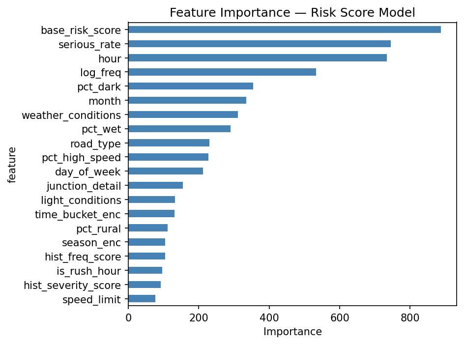 | 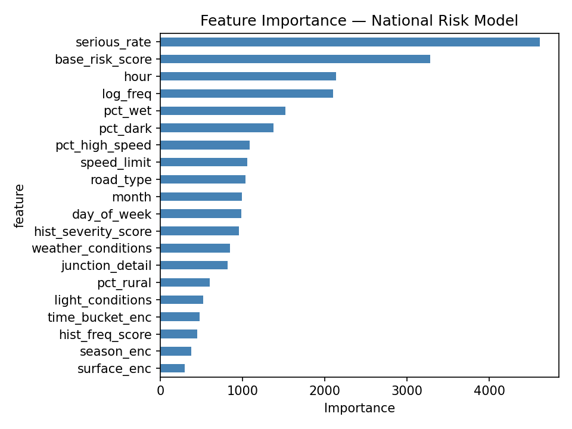 |

## Exploratory analysis

**When collisions happen**

| By hour | By day of week |
|---|---|
| 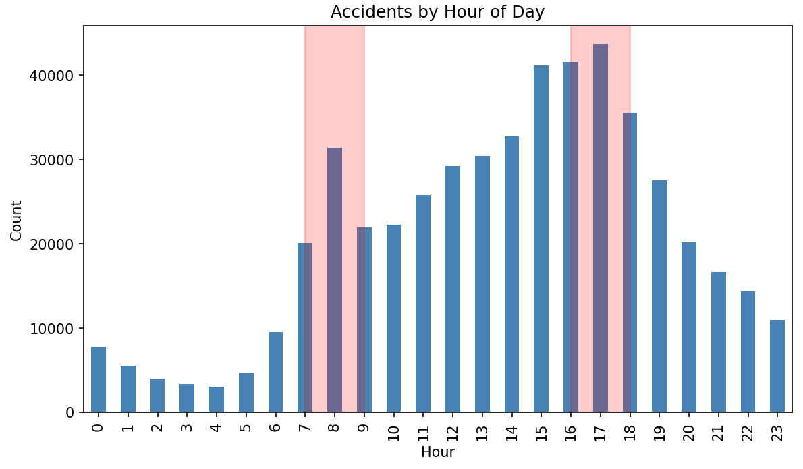 | 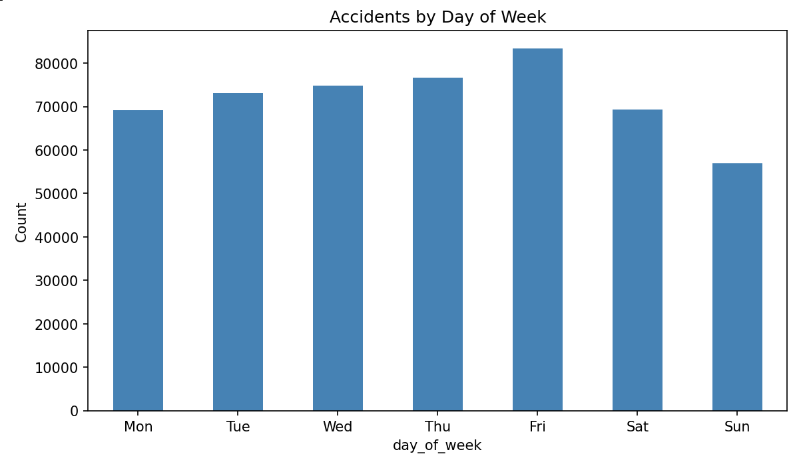 |

| By month | By year |
|---|---|
| 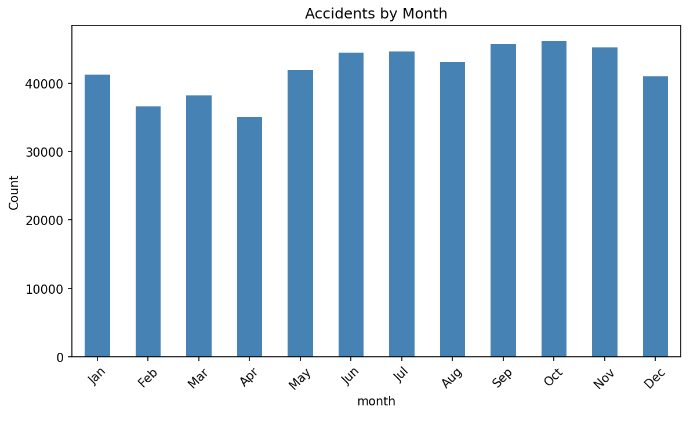 | 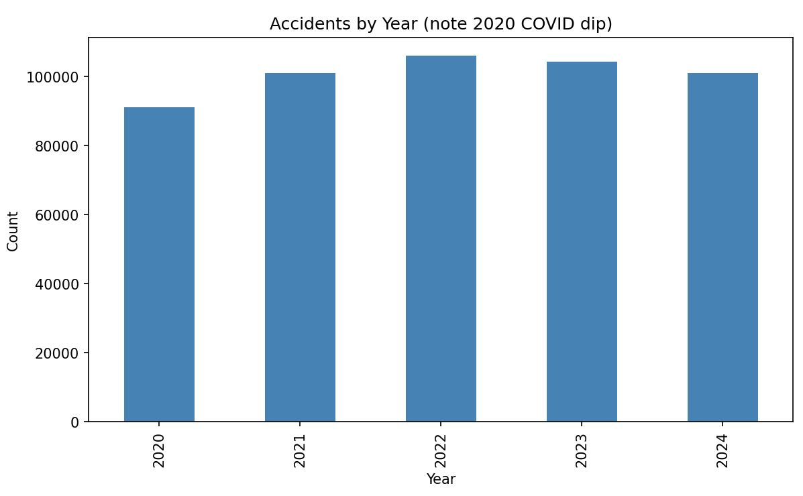 |

**Conditions**

| Severity | Weather |
|---|---|
| 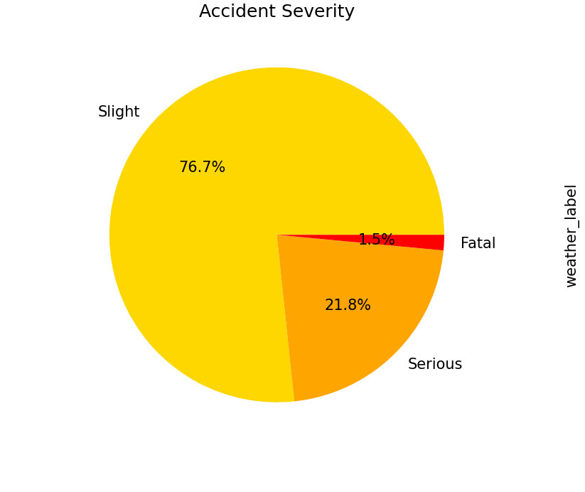 | 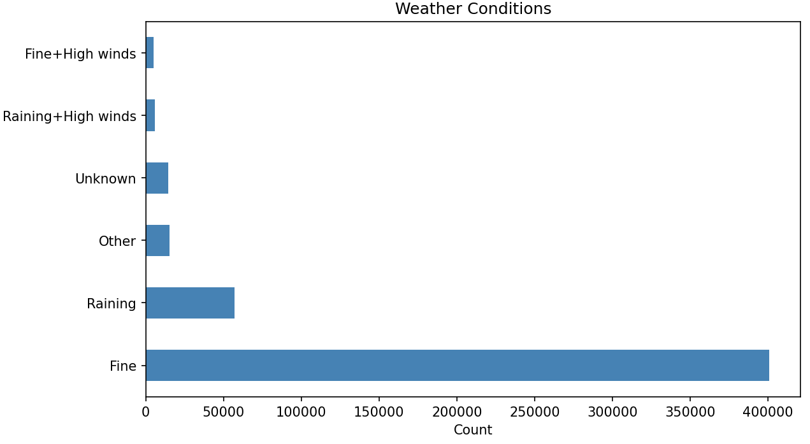 |

| Road surface | Speed limit |
|---|---|
| 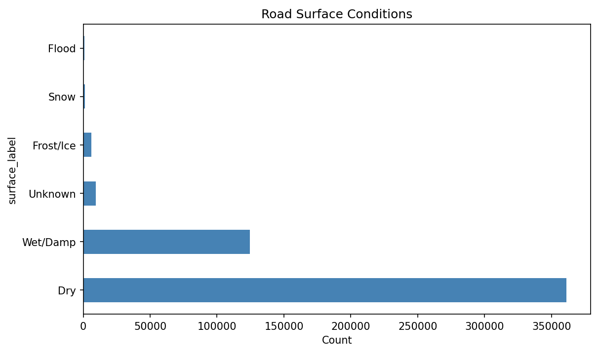 | 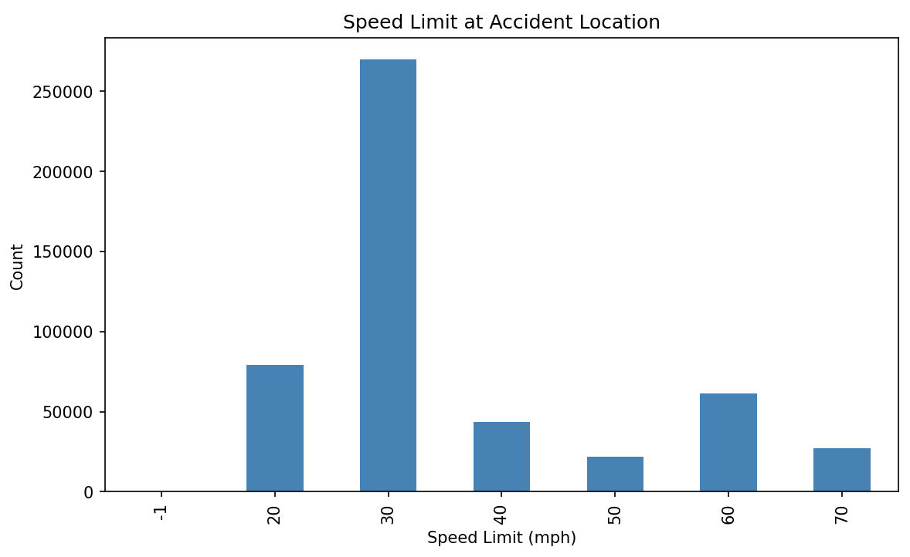 |

**Severity breakdowns**

| By light conditions | By road type | By speed limit |
|---|---|---|
| 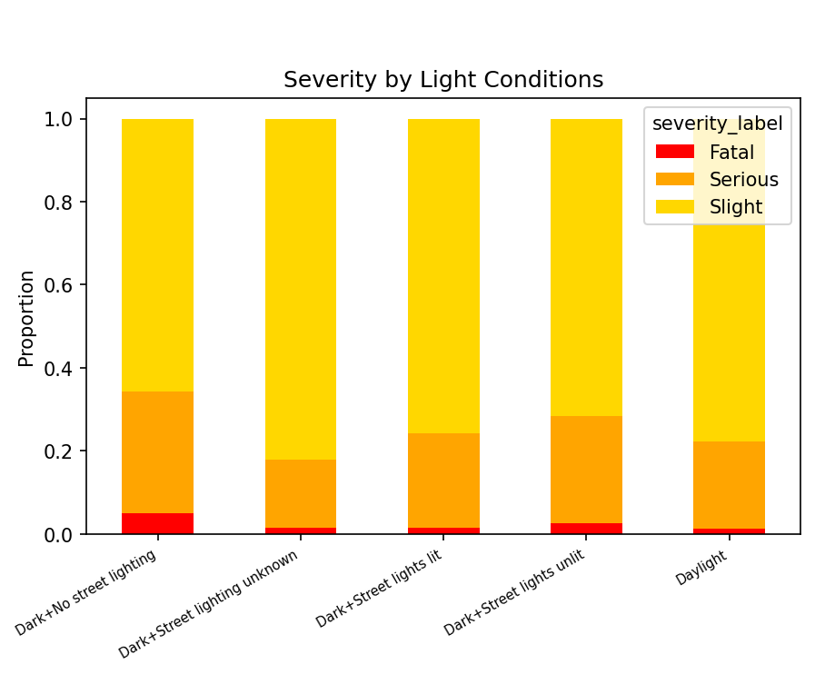 | 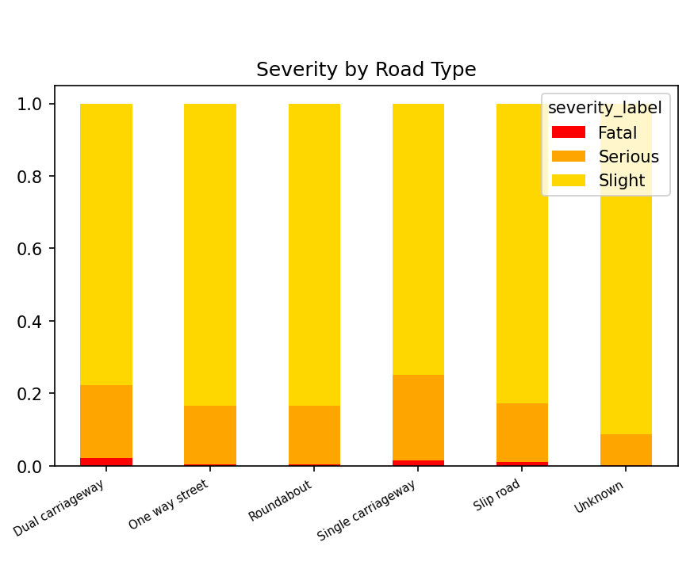 | 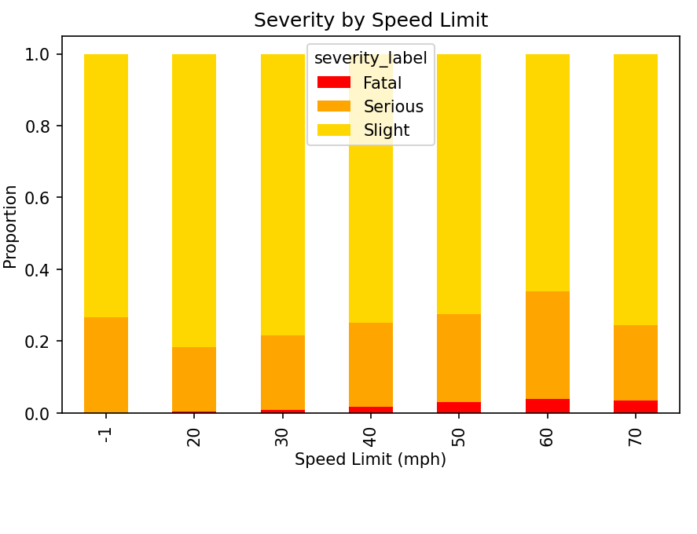 |

**Summary panels**

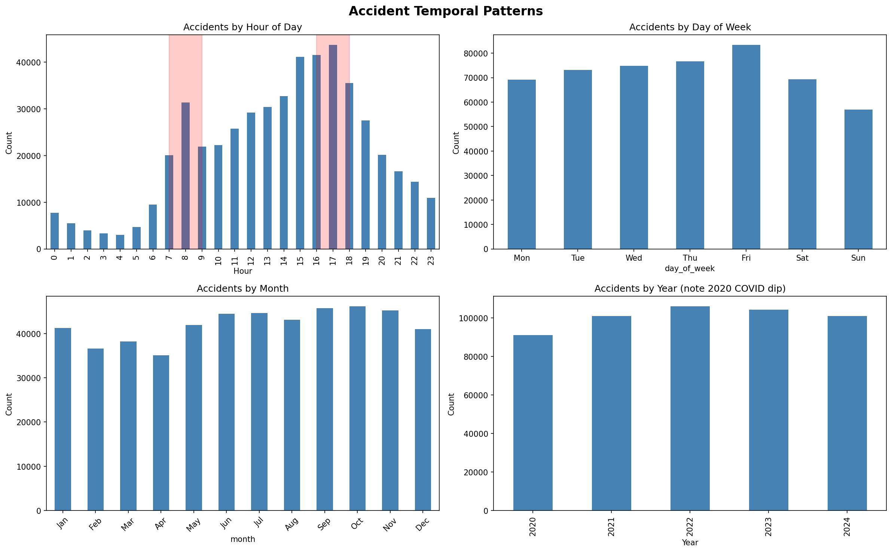
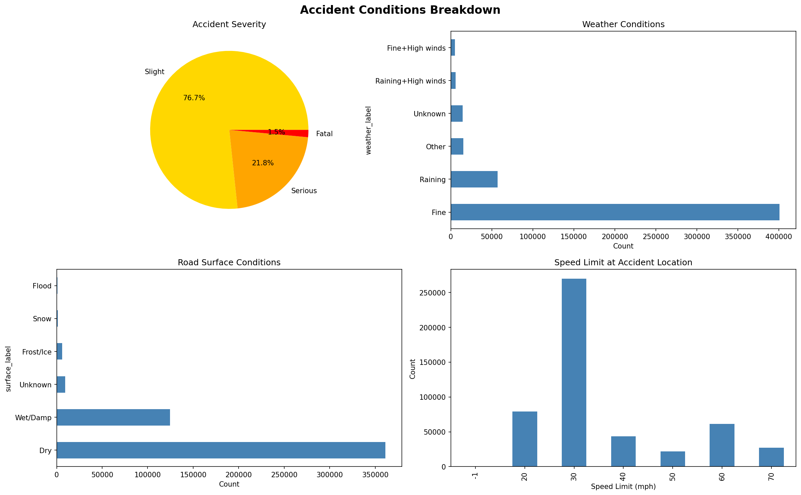
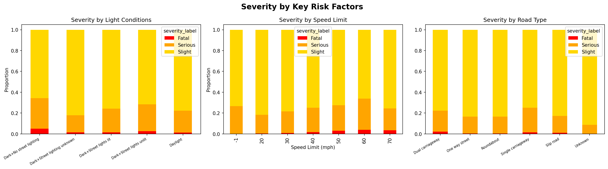

## Data

All the data is public and is not stored in this repo:

- [STATS19 road safety data](https://www.data.gov.uk/dataset/cb7ae6f0-4be6-4935-9277-47e5ce24a11f/road-accidents-safety-data) (Department for Transport). Notebook 1.1 downloads it automatically.
- [DfT road traffic counts (AADF)](https://roadtraffic.dft.gov.uk/downloads)
- OpenStreetMap road network, fetched through OSMnx

## Running it

The notebooks were written for Google Colab. Set `DATA_DIR` to a working folder; the notebooks create `datasets/`, `models/` and `figures/` inside it. Run them in numbered order.

```bash
pip install -r requirements.txt
```

**Tech:** Python, pandas, GeoPandas, OSMnx, Shapely, LightGBM, scikit-learn, matplotlib
